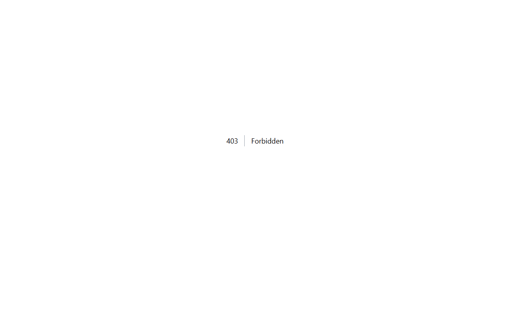

# Car Rental

Standalone Laravel app for vehicle browsing, date/time availability, reservation and cancellation, server-priced extras, admin fleet/reservation/maintenance management, and CSV reservation reporting.

## Setup (Windows)

```powershell
Copy-Item .env.example .env
php C:/Users/wondr/.config/herd-lite/bin/composer.phar install
npm install
php artisan key:generate
php artisan migrate --seed
php artisan storage:link
npm run build
php artisan serve
```

Public registration creates customer accounts only. A trusted operator must grant `users.is_admin = 1` through a secure database/administrative process. Admin tools: `/admin/rentals`. Add vehicles and schedule maintenance there. Vehicle images are optional and public; do not upload identity documents. No license verification or payment integration is provided.

## Booking rules

- Reservations use half-open intervals `[starts_at, ends_at)`; adjacent rentals do not overlap.
- At least one billable day; partial days round up. Total = (vehicle daily rate + selected active extras' daily rates) × billable days. Prices are recalculated server-side; client-submitted totals are ignored. Extra rates are snapshotted on each booking.
- Customer reservation and maintenance allocation run in DB transactions while locking the vehicle row. Use PostgreSQL/MySQL for cross-process row-lock protection in production; SQLite development/tests do not establish concurrent booking safety.
- Customers can cancel only their own confirmed booking before its start. Admin access is guarded by `is_admin`; personal document collection is intentionally absent.

## Verification

```powershell
php artisan migrate:fresh --seed --no-interaction
php artisan view:clear
php artisan view:cache
php artisan test --compact
npm run build
php C:/Users/wondr/.config/herd-lite/bin/composer.phar validate --no-check-publish
php C:/Users/wondr/.config/herd-lite/bin/composer.phar audit
npm audit --omit=dev
```

CSV reports contain actual confirmed reservations, not synthetic analytics. Setup seeds no sample vehicles or customer records. Keep `.env`, databases, dependencies, uploaded files, and build output out of Git.

## Screenshots

### Dashboard Overview


### Login Overview

